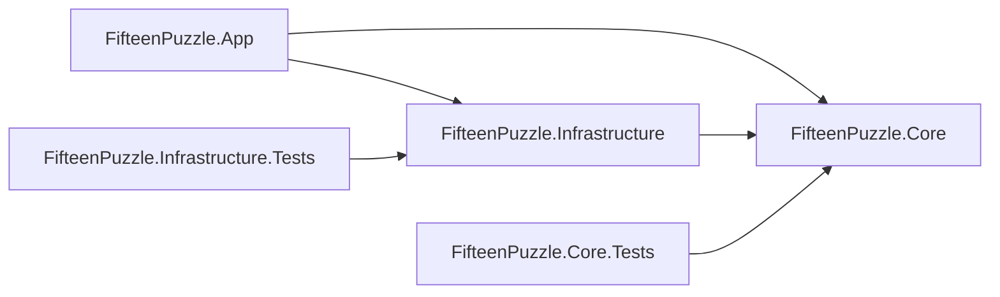
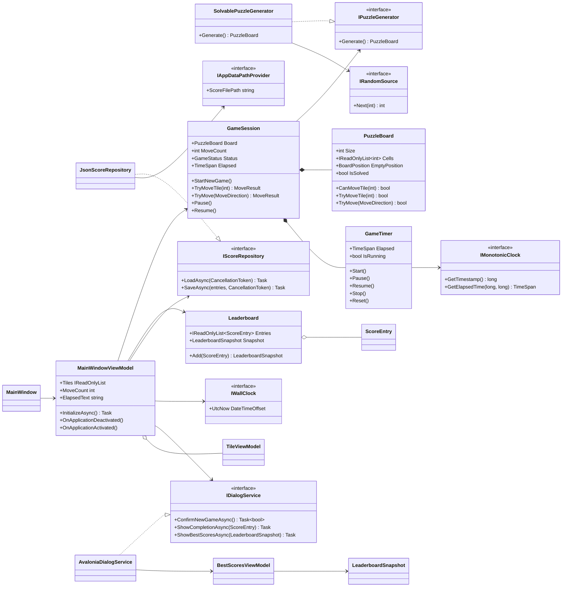
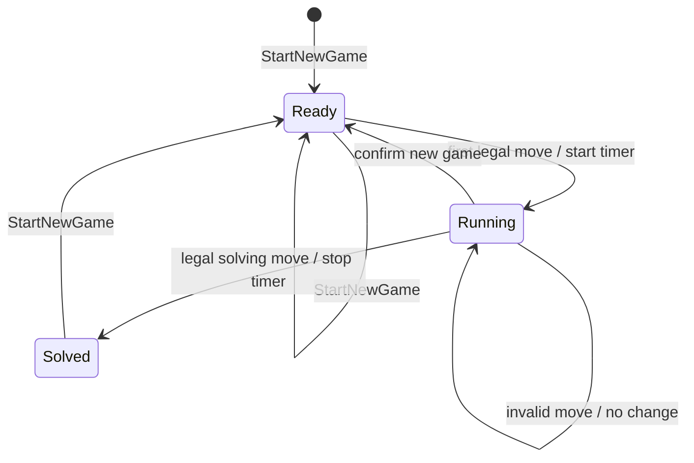
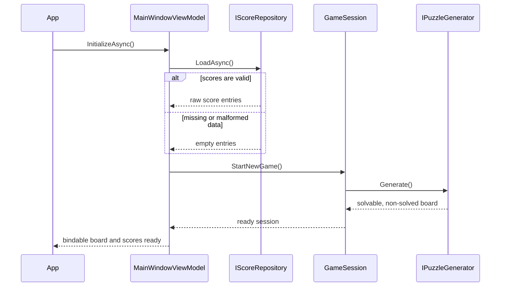
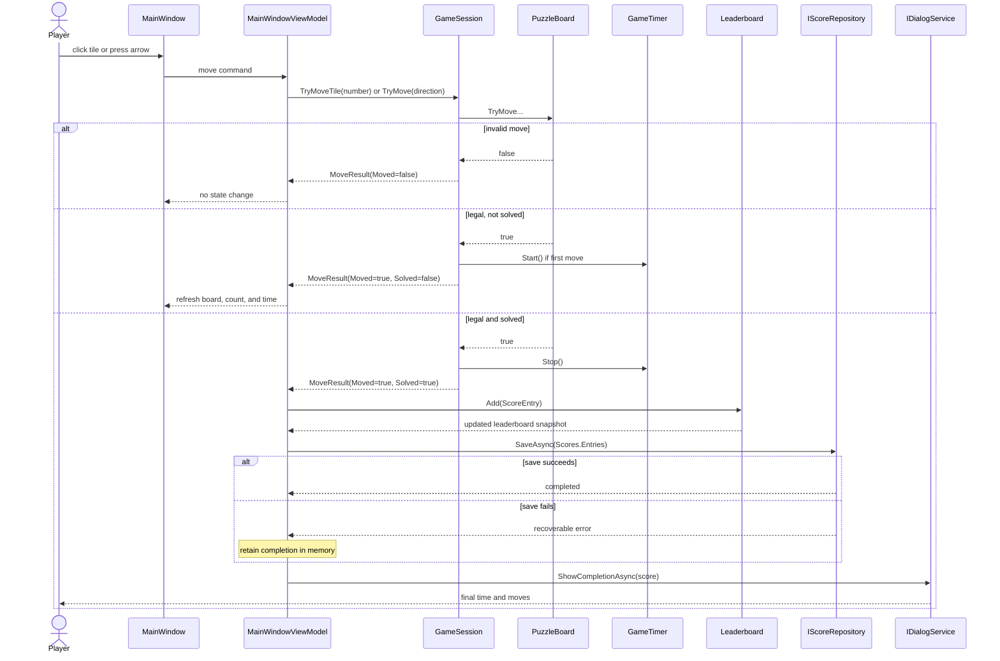
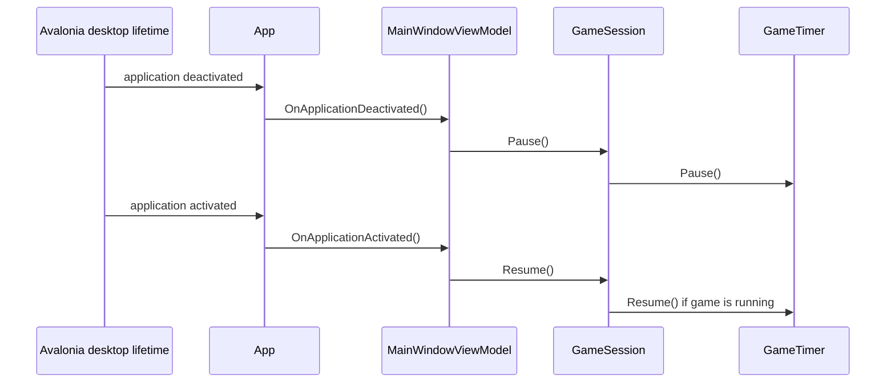

# 15 Puzzle Design

## 1. Purpose

This document translates [REQUIREMENTS.md](REQUIREMENTS.md) into an implementation design for a C# and Avalonia UI desktop application. The design uses MVVM at the UI boundary and keeps puzzle rules, elapsed-time accounting, and leaderboard ranking independent of Avalonia so they can be tested without launching the application.

## 2. Architectural Overview

The solution is divided into three production projects and two test projects:

| Project | Responsibility | Dependencies |
| --- | --- | --- |
| `FifteenPuzzle.Core` | Puzzle rules, game session, monotonic timer, score ranking, and contracts | .NET only |
| `FifteenPuzzle.Infrastructure` | Random generation, system clock, JSON score storage, and macOS data path | `FifteenPuzzle.Core` |
| `FifteenPuzzle.App` | Avalonia views, view models, commands, dialogs, lifecycle, and composition root | Core, Infrastructure, Avalonia |
| `FifteenPuzzle.Core.Tests` | Unit and property-style tests for all domain behavior | Core |
| `FifteenPuzzle.Infrastructure.Tests` | File persistence and contract tests using temporary directories | Core, Infrastructure |

Dependencies point inward: UI and infrastructure depend on abstractions in Core. Core has no dependency on Avalonia, file formats, operating-system APIs, or wall-clock time.



## 3. Key Design Decisions

### 3.1 State ownership

`GameSession` is the aggregate that owns the current `PuzzleBoard`, move count, status, and `GameTimer`. A move can occur only through `GameSession.TryMove`; this prevents pointer and keyboard paths from applying different rules.

`PuzzleBoard` mutates only after validating a requested move. It never exposes its backing array. Callers receive an immutable snapshot, preventing UI binding code from corrupting game state.

### 3.2 Time

`GameTimer` computes elapsed time from `IMonotonicClock`, not `DateTime`. It accumulates completed active intervals and excludes inactive intervals. The first successful move starts it; new-game confirmation and application deactivation pause it. A one-second Avalonia UI timer only refreshes the displayed value and is not the source of truth.

Completion dates use `IWallClock.UtcNow` because they are calendar values rather than durations.

### 3.3 Persistence

`IScoreRepository` stores only raw score entries. Ranking and truncation belong to `Leaderboard`, keeping persistence format concerns separate from scoring rules. `JsonScoreRepository` writes a temporary file in the destination directory and atomically replaces the prior file. Missing or malformed data returns an empty collection and a recoverable warning.

### 3.4 UI coordination

`MainWindowViewModel` coordinates one `GameSession`, dialogs, and score persistence. It does not calculate legal moves, solvability, elapsed duration, or rankings. Pointer and keyboard input both call the same move command.

Dialogs are reached through `IDialogService`, allowing view-model tests to supply deterministic answers without creating Avalonia windows.

## 4. Core Types

### 4.1 Value types and enums

#### `BoardPosition`

An immutable `readonly record struct` containing zero-based `Row` and `Column`. Construction rejects values outside 0 through 3.

#### `MoveDirection`

Values: `Up`, `Down`, `Left`, and `Right`. The direction describes the numbered tile's movement into the empty cell. Therefore, `Left` selects the tile immediately to the right of the empty cell.

#### `GameStatus`

Values: `Ready`, `Running`, and `Solved`.

#### `MoveResult`

An immutable result with:

- `Moved`: whether board state changed.
- `Solved`: whether this move completed the puzzle.
- `MoveCount`: the count after the operation.
- `Elapsed`: elapsed active time after the operation.

Invalid moves return `Moved = false` and preserve all session state.

#### `ScoreEntry`

An immutable record containing `Elapsed`, `MoveCount`, and `CompletedAtUtc`.

#### `LeaderboardSnapshot`

An immutable record containing `FastestTimes` and `FewestMoves`, each exposed as a read-only list with at most 10 entries.

## 5. Class Decomposition

### 5.1 Core domain

#### `PuzzleBoard`

Owns the 16-cell board representation and all legal-move rules.

```csharp
public sealed class PuzzleBoard
{
    public const int Size = 4;
    public IReadOnlyList<int> Cells { get; }
    public BoardPosition EmptyPosition { get; }
    public bool IsSolved { get; }

    public PuzzleBoard(IEnumerable<int> cells);
    public bool CanMoveTile(int tileNumber);
    public bool TryMoveTile(int tileNumber);
    public bool TryMove(MoveDirection direction);
}
```

`0` represents the empty cell internally and in persisted/debug snapshots. The constructor validates exactly 16 values containing every integer from 0 through 15 once. It accepts both solvable and unsolvable layouts so rules can be tested independently; generation is responsible for providing playable layouts.

#### `IPuzzleGenerator`

```csharp
public interface IPuzzleGenerator
{
    PuzzleBoard Generate();
}
```

Returns a valid, solvable, non-solved board.

#### `SolvablePuzzleGenerator`

Creates a Fisher-Yates permutation of 0 through 15, rejects solved layouts, and applies the even-width inversion rule:

- If the empty-cell row from the bottom is odd, the inversion count must be even.
- If the empty-cell row from the bottom is even, the inversion count must be odd.

Generation repeats until all conditions hold. Randomness is supplied by `IRandomSource` to permit deterministic tests.

#### `IRandomSource`

```csharp
public interface IRandomSource
{
    int Next(int exclusiveUpperBound);
}
```

#### `GameTimer`

Owns monotonic elapsed-time accounting.

```csharp
public sealed class GameTimer
{
    public TimeSpan Elapsed { get; }
    public bool IsStarted { get; }
    public bool IsRunning { get; }

    public GameTimer(IMonotonicClock clock);
    public void Start();
    public void Pause();
    public void Resume();
    public void Stop();
    public void Reset();
}
```

All operations are idempotent where practical. `Resume` has no effect before `Start` or after `Stop`.

#### `GameSession`

Coordinates a board, timer, move count, and status as one consistent state machine.

```csharp
public sealed class GameSession
{
    public PuzzleBoard Board { get; }
    public int MoveCount { get; }
    public GameStatus Status { get; }
    public TimeSpan Elapsed { get; }
    public bool HasActiveGame { get; }

    public GameSession(IPuzzleGenerator generator, GameTimer timer);
    public void StartNewGame();
    public MoveResult TryMoveTile(int tileNumber);
    public MoveResult TryMove(MoveDirection direction);
    public void Pause();
    public void Resume();
}
```

Both move methods delegate to one private move pipeline. On a legal move, the pipeline updates the board, increments the count, starts the timer if needed, checks completion, and stops the timer if solved. `HasActiveGame` is true only after at least one move and before completion.

#### `IMonotonicClock` and `IWallClock`

```csharp
public interface IMonotonicClock
{
    long GetTimestamp();
    TimeSpan GetElapsedTime(long startTimestamp, long endTimestamp);
}

public interface IWallClock
{
    DateTimeOffset UtcNow { get; }
}
```

Separating these clocks prevents duration calculations from depending on calendar changes while keeping completion dates testable.

#### `Leaderboard`

Owns ranking, tie-breaking, and the 10-entry limits.

```csharp
public sealed class Leaderboard
{
    public Leaderboard(IEnumerable<ScoreEntry> entries);
    public IReadOnlyList<ScoreEntry> Entries { get; }
    public LeaderboardSnapshot Snapshot { get; }
    public LeaderboardSnapshot Add(ScoreEntry entry);
}
```

The class retains the union of entries qualifying for either list, de-duplicates identical entries, and constructs each sorted projection according to the requirements. `Entries` exposes that retained union for persistence; it is not a third user-visible ranking.

#### `IScoreRepository`

```csharp
public interface IScoreRepository
{
    Task<IReadOnlyList<ScoreEntry>> LoadAsync(CancellationToken cancellationToken);
    Task SaveAsync(IReadOnlyList<ScoreEntry> entries, CancellationToken cancellationToken);
}
```

### 5.2 Infrastructure

#### `SystemMonotonicClock`

Implements `IMonotonicClock` with `System.Diagnostics.Stopwatch.GetTimestamp()` and `Stopwatch.GetElapsedTime()`.

#### `SystemWallClock`

Implements `IWallClock` with `DateTimeOffset.UtcNow`.

#### `SystemRandomSource`

Implements `IRandomSource` with one private `Random` instance. Calls occur on the UI thread; no cross-thread guarantee is required.

#### `IAppDataPathProvider`

```csharp
public interface IAppDataPathProvider
{
    string ScoreFilePath { get; }
}
```

The macOS implementation resolves a product-specific path beneath `Environment.SpecialFolder.ApplicationData`. Tests provide a temporary path.

#### `JsonScoreRepository`

Implements `IScoreRepository` with `System.Text.Json`. The document has a schema version and raw entries:

```json
{
  "version": 1,
  "entries": [
    {
      "elapsedMilliseconds": 92543,
      "moveCount": 142,
      "completedAtUtc": "2026-09-02T10:15:30Z"
    }
  ]
}
```

Loading a missing file returns an empty list. Invalid JSON, unknown versions, or invalid entries are quarantined by renaming the source file with a `.corrupt` suffix when possible, then return an empty list. Saving creates the directory, writes and flushes a sibling temporary file, and atomically replaces the destination.

### 5.3 Avalonia application

#### `App`

Creates infrastructure services and view models in the composition root, opens `MainWindow`, and forwards desktop activation/deactivation events to `MainWindowViewModel`.

#### `MainWindow`

Defines the main Avalonia view. It owns only view concerns: square board sizing, keyboard event translation, focus restoration after dialogs, and accessibility properties bound from the view model.

#### `MainWindowViewModel`

```csharp
public sealed partial class MainWindowViewModel : ObservableObject
{
    public IReadOnlyList<TileViewModel> Tiles { get; }
    public int MoveCount { get; }
    public string ElapsedText { get; }
    public string StatusAnnouncement { get; }
    public bool IsInputEnabled { get; }

    public IRelayCommand<int> MoveTileCommand { get; }
    public IRelayCommand<MoveDirection> MoveDirectionCommand { get; }
    public IAsyncRelayCommand NewGameCommand { get; }
    public IAsyncRelayCommand ShowBestScoresCommand { get; }

    public Task InitializeAsync();
    public void OnApplicationDeactivated();
    public void OnApplicationActivated();
}
```

Responsibilities:

- Initializes scores and starts the first board.
- Maps both input modes into `GameSession` calls.
- Rebuilds tile snapshots and raises bindable properties after legal moves.
- Refreshes `ElapsedText` once per second while the session timer is running.
- Tracks `ApplicationInactive` and `NewGameConfirmation` pause reasons and resumes the session only when no pause reason remains.
- Serializes commands with `IsInputEnabled` so concurrent inputs cannot overlap.
- On completion, announces status, updates the leaderboard, attempts persistence, and displays completion results even if saving fails.

The pause-reason set handles overlapping events safely. For example, reactivating the application cannot resume the timer while a new-game confirmation is still open. Opening Best Scores does not pause an active game; elapsed time continues because the requirements grant a pause only for application inactivity and new-game confirmation.

#### `TileViewModel`

An immutable presentation snapshot containing `Number`, `Row`, `Column`, `IsEmpty`, `CanMove`, and `AccessibleName`. Numbered accessible names include number and position; the empty-cell name includes its position.

#### `BestScoresViewModel`

Exposes the two already-ranked lists from `LeaderboardSnapshot`, formatted values, empty-state flags, and a close command. It never changes the current `GameSession`.

#### `IDialogService`

```csharp
public interface IDialogService
{
    Task<bool> ConfirmNewGameAsync(CancellationToken cancellationToken);
    Task ShowCompletionAsync(ScoreEntry score, CancellationToken cancellationToken);
    Task ShowBestScoresAsync(
        LeaderboardSnapshot scores,
        CancellationToken cancellationToken);
}
```

#### `AvaloniaDialogService`

Creates modal Avalonia windows with explicit default/cancel behavior and accessible labels. It returns only typed results to the view model.

#### `NewGameDialog`, `CompletionDialog`, and `BestScoresDialog`

Views responsible for layout, focus order, Escape behavior, and binding. They contain no domain decisions.

## 6. Class Diagram



## 7. State Model



Pause is an orthogonal timer condition rather than a game status. A `Running` game remains `Running` while its timer is paused for a modal dialog or application deactivation.

## 8. Sequence Diagrams

### 8.1 Startup and initial board



### 8.2 Move and puzzle completion



### 8.3 New game confirmation

```mermaid
sequenceDiagram
    actor Player
    participant VM as MainWindowViewModel
    participant Session as GameSession
    participant Dialog as IDialogService

    Player->>VM: NewGameCommand
    alt no active game
        VM->>Session: StartNewGame()
    else game is active
        VM->>Session: Pause()
        VM->>Dialog: ConfirmNewGameAsync()
        alt player cancels
            Dialog-->>VM: false
            VM->>Session: Resume()
            Note over VM,Session: board, count, and elapsed time preserved
        else player continues
            Dialog-->>VM: true
            VM->>Session: StartNewGame()
            Note over VM,Session: board replaced; count and timer reset
        end
    end
```

### 8.4 Application deactivation and activation



## 9. Error Handling

- Invalid game input is an expected no-op, not an exception.
- Invalid constructor state in `PuzzleBoard` throws `ArgumentException`; such state indicates a programming or deserialization defect.
- Score-load failures produce an empty leaderboard and a non-blocking diagnostic log entry.
- Score-save failures preserve the in-memory result and still show completion.
- Dialog cancellation is a normal result.
- Unexpected command exceptions are logged and restore `IsInputEnabled` in a `finally` block.
- No persistence exception crosses into Avalonia's UI event loop.

Logging uses `Microsoft.Extensions.Logging` abstractions. The release configuration writes diagnostics locally without collecting telemetry.

## 10. Concurrency and Responsiveness

- Board operations execute synchronously on the Avalonia UI thread and are expected to complete well under 100 ms.
- File operations are asynchronous and accept cancellation tokens.
- `IsInputEnabled` and command `CanExecute` prevent a second command while a modal or persistence transition is active.
- View-bound collections are replaced or updated only on the UI thread.
- Shutdown may cancel an in-progress load; score saves use a short application-owned shutdown completion window to reduce data loss.

## 11. Test Design

### 11.1 Core unit tests

- Constructor accepts exactly one of every cell value and rejects all malformed boards.
- Every legal and illegal tile/direction move is tested at corners, edges, and center positions.
- Solved detection is true only for canonical order.
- At least 1,000 seeded generated boards are complete, solvable, and non-solved.
- `GameSession` starts the timer only after a legal first move and increments only legal moves.
- A solving move transitions once to `Solved` and freezes elapsed time.
- A fake monotonic clock verifies pause/resume and excludes inactive intervals exactly.
- Leaderboard tests cover sorting, all tie-breakers, de-duplication, dual qualification, and limits.

### 11.2 Infrastructure tests

- Missing score file loads as empty.
- A round trip preserves all score fields.
- Invalid JSON, unsupported versions, and invalid entries do not escape as startup failures.
- Interrupted-save simulation leaves either the old complete file or the new complete file.
- A temporary `IAppDataPathProvider` keeps tests isolated from user data.

### 11.3 View-model tests

- Pointer and direction commands produce equivalent session transitions.
- New-game cancel preserves board, count, status, and elapsed duration.
- Completion is shown even when repository save throws.
- Repeated input is disabled during dialogs.
- Activation and deactivation forward pause/resume correctly.
- Tile accessible names contain number or empty state plus row and column.
- Timer refresh changes display text without announcing each tick.

### 11.4 UI and accessibility tests

- Avalonia headless tests verify bindings, focus order, default/cancel actions, and keyboard commands.
- A packaged macOS smoke test verifies VoiceOver names, completion announcement, minimum window layout, square board behavior, and application lifecycle events.

## 12. Requirements Traceability

| Acceptance criterion | Owning design elements | Primary verification |
| --- | --- | --- |
| Solvable non-solved generation | `SolvablePuzzleGenerator`, `IRandomSource` | Seeded 1,000-board test |
| Legal orthogonal movement | `PuzzleBoard` | Board unit tests |
| Move count integrity | `GameSession` | Session unit tests |
| Timer lifecycle | `GameTimer`, `GameSession`, app lifecycle | Fake-clock and lifecycle tests |
| Equivalent pointer/keyboard behavior | `MainWindowViewModel` shared move pipeline | View-model tests |
| New-game confirmation | `MainWindowViewModel`, `IDialogService` | Cancel/continue tests |
| Completion and score update | `GameSession`, `Leaderboard` | Session and ranking tests |
| Ranking and top-10 limits | `Leaderboard` | Parameterized ranking tests |
| Durable and corrupt-safe scores | `JsonScoreRepository` | Temporary-file integration tests |
| Keyboard-only operation | Avalonia views and commands | Headless plus macOS smoke test |
| Screen-reader semantics | `TileViewModel`, Avalonia automation properties | VoiceOver smoke test |
| Responsive square layout | `MainWindow` | Resize UI tests |

## 13. Dependency Choices

- **Avalonia UI:** cross-platform desktop UI framework selected by the requirements.
- **CommunityToolkit.Mvvm:** observable properties and relay commands with minimal view-model boilerplate.
- **System.Text.Json:** built-in versioned score serialization.
- **Microsoft.Extensions.Logging.Abstractions:** testable diagnostics without coupling Core to a logging destination.
- **xUnit:** unit and integration test framework.

No dependency is required for puzzle solvability, ranking, timing, or atomic file replacement.

## 14. Deferred Implementation Details

- The minimum window dimensions will be fixed after the first Avalonia layout prototype.
- The final macOS target framework and runtime identifiers will follow the installed supported .NET SDK and Avalonia version.
- Exact typography, colors, spacing, and focus visuals belong in a separate UI specification or prototype.
- Packaging, signing, and notarization remain outside this design unless release requirements change.