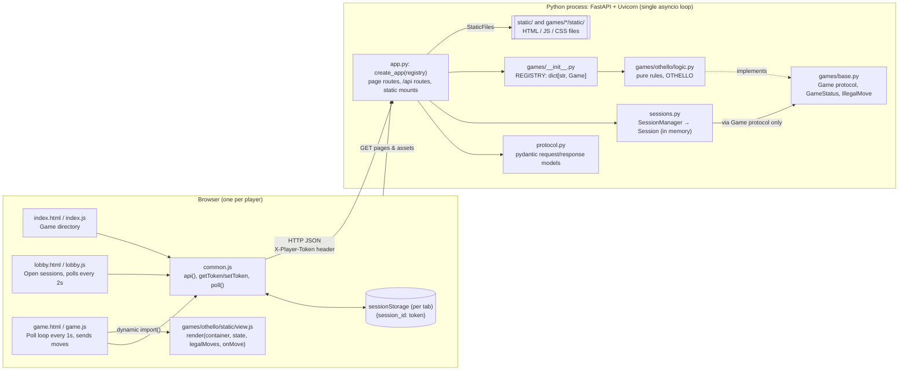

# Architecture — Components & Runtime

One local process (FastAPI + Uvicorn on `127.0.0.1:8000`) serves the static
client and the JSON API. Browsers poll it over plain HTTP. There are no
WebSockets, and the server keeps no per-client state (design decisions 1, 5,
6, 7).

## Key properties
- **Rules live only in game modules.** `app.py` and `sessions.py` never
  import `games.othello`. They reach games only through `REGISTRY` and the
  `Game` protocol.
- **The server is the source of truth.** Clients send intentions (moves),
  the server validates and applies them, and clients learn the outcome by
  polling.
- **Stateless clients.** The token maps to a seat and nothing more. The
  server tracks no presence or last-seen time.
- **In-memory only.** Nothing survives a restart, and there is no cleanup
  in v1.
