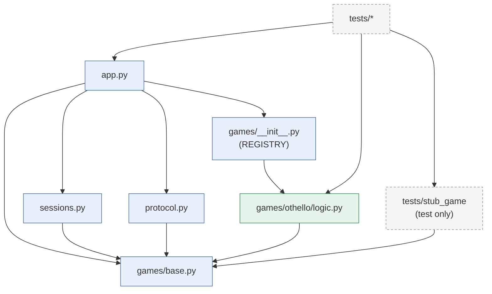

# Design — Module Dependencies

Allowed import directions inside `src/gamer/`. An arrow means "imports".
Game packages depend only on `games/base.py`. Nothing in the core imports a
concrete game except the registry.

## Forbidden edges
- `sessions.py` or `app.py` → `games/othello/*` (game-specific code in the core)
- `games/othello/logic.py` → FastAPI, asyncio, or `sessions.py` (logic must
  stay pure, `SPEC.md:29`)
- Production `REGISTRY` → `tests/stub_game`
