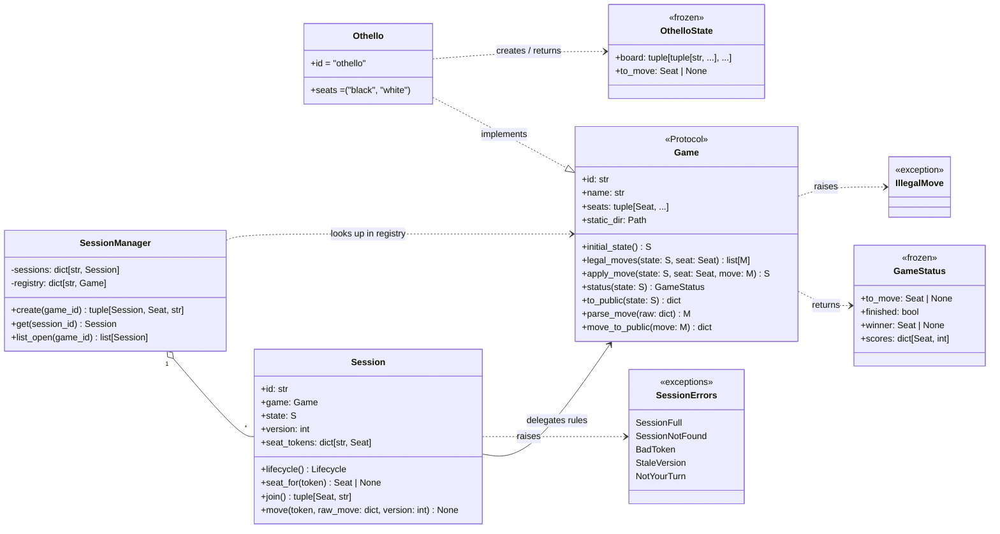
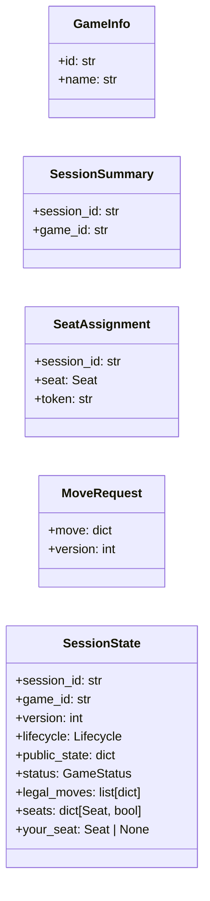

# Design — Domain Model & Game Interface

Core types from `structure.md`. `Game` is a `typing.Protocol`, and game
states are immutable (frozen dataclasses).

## API models (`protocol.py`)

## HTTP endpoints

| Method & path | Request | Response | Errors |
|---|---|---|---|
| `GET /api/games` | none | `list[GameInfo]` | none |
| `GET /api/games/{game}/sessions` | none | `list[SessionSummary]` (waiting only) | 404 game |
| `POST /api/games/{game}/sessions` | none | `SeatAssignment` | 404 game |
| `POST /api/sessions/{id}/join` | none | `SeatAssignment` | 404, 409 full |
| `GET /api/sessions/{id}/state` | optional token | `SessionState` | 403, 404 |
| `POST /api/sessions/{id}/moves` | token + `MoveRequest` | `SessionState` | 400, 403, 404, 409 |
