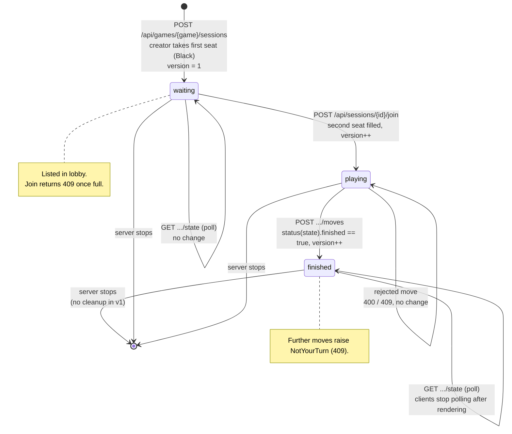

# Design — Session Lifecycle

`Session.lifecycle` is derived from seat occupancy and `game.status(state)`.
It is not stored separately. `version` goes up on every transition and on
every applied move (design decision 8).

