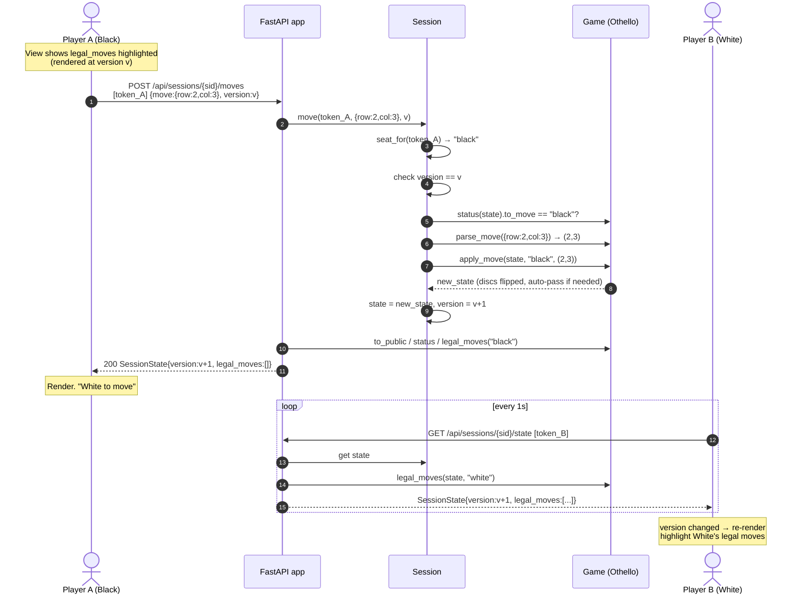
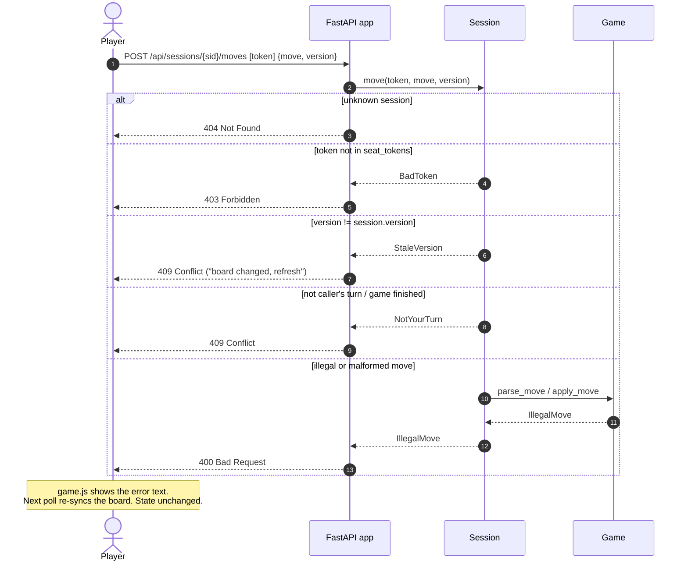

# Sequence — Make a Move & Opponent Sees It by Polling

The mover gets the new state straight from the `POST` response. The opponent
picks it up on their next poll (≤ ~1s). Validation and application run with
no `await` between them, so each request is atomic on the event loop
(design decision 6).

## Rejected moves

