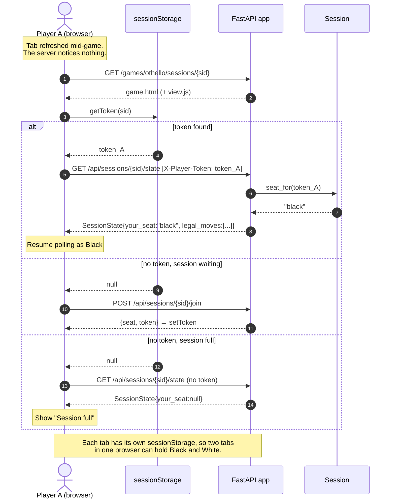

# Sequence — Refresh Reclaims the Seat

The server keeps no per-client state, so "reconnecting" is just polling
again with the token in `sessionStorage`. That store is per tab: it survives
a refresh, but closing the tab loses the token and the seat. The server cannot
see that the tab was refreshed or closed, and the opponent sees no change (design decision 7).

