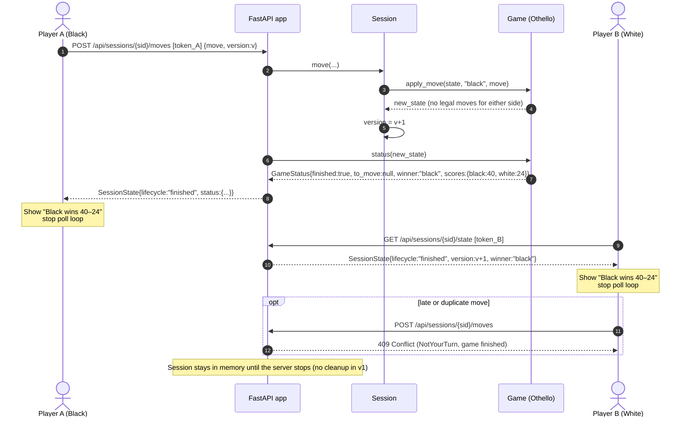

# Sequence — Final Move & Game Over

The last legal move leaves neither side able to move. `status()` reports
`finished`, both clients show the result, and polling stops.

Draw: `winner: null` with equal scores. The UI shows "Draw 32–32".
