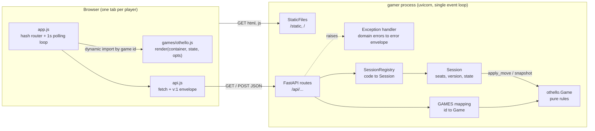
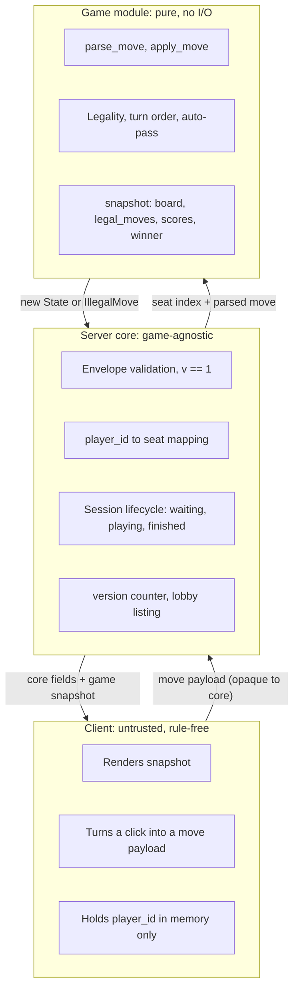

# Architecture Diagram

Companion to `design.md`. Shows runtime components and the boundaries between them.

## Runtime Components

One `uv run gamer` process serves both the static client and the JSON API. All state lives in memory on a single asyncio event loop (Design Decisions 2, 3).

## Trust and Responsibility Boundaries

Rules that follow from these boundaries:

- The client never decides whether a move is legal. It only highlights `legal_moves` from the snapshot.
- The core never inspects `board` or the move payload, and never imports a specific game.
- The game never sees names or `player_id`s, only seat indexes.
