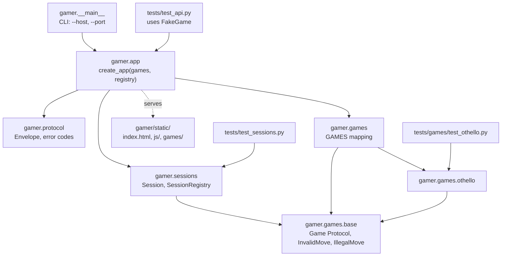
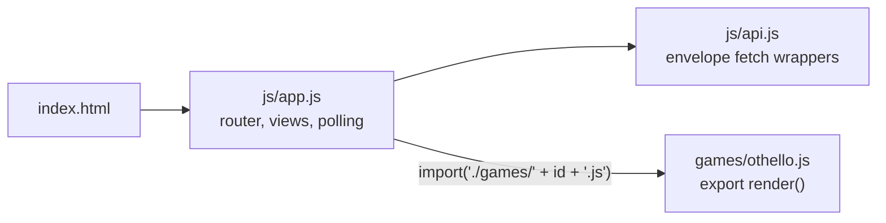
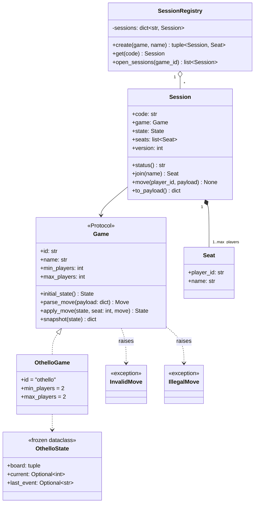
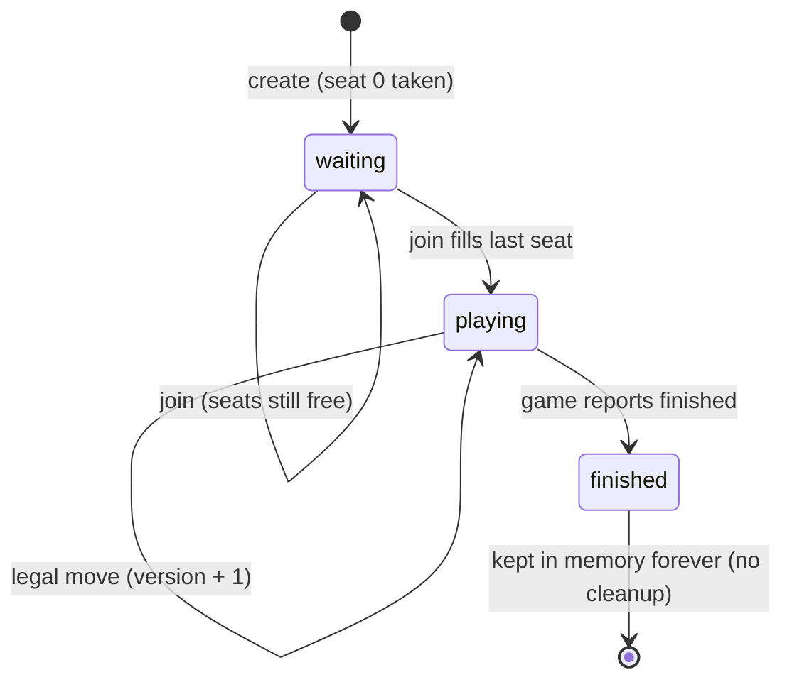

# Module Diagram

Companion to `design.md`. Shows the planned package layout, the import directions, and the key types. The exact file split is settled in the Structure phase.

## Package Dependencies

Arrows mean "imports". The rule: nothing under `gamer.games` imports from the server core, and the core imports only `gamer.games` (the `GAMES` mapping and `base`), never `othello` directly.

## Client Modules

## Key Types

## Session Status

The status is `waiting` until every seat is filled. After that it follows the game's `snapshot()["status"]`.

