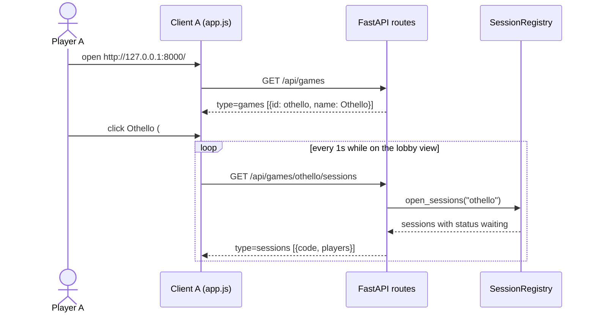
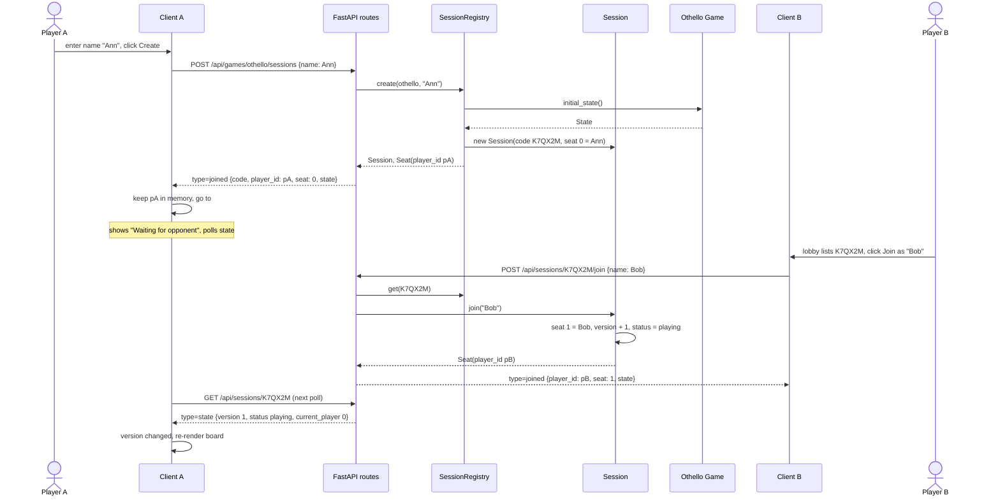
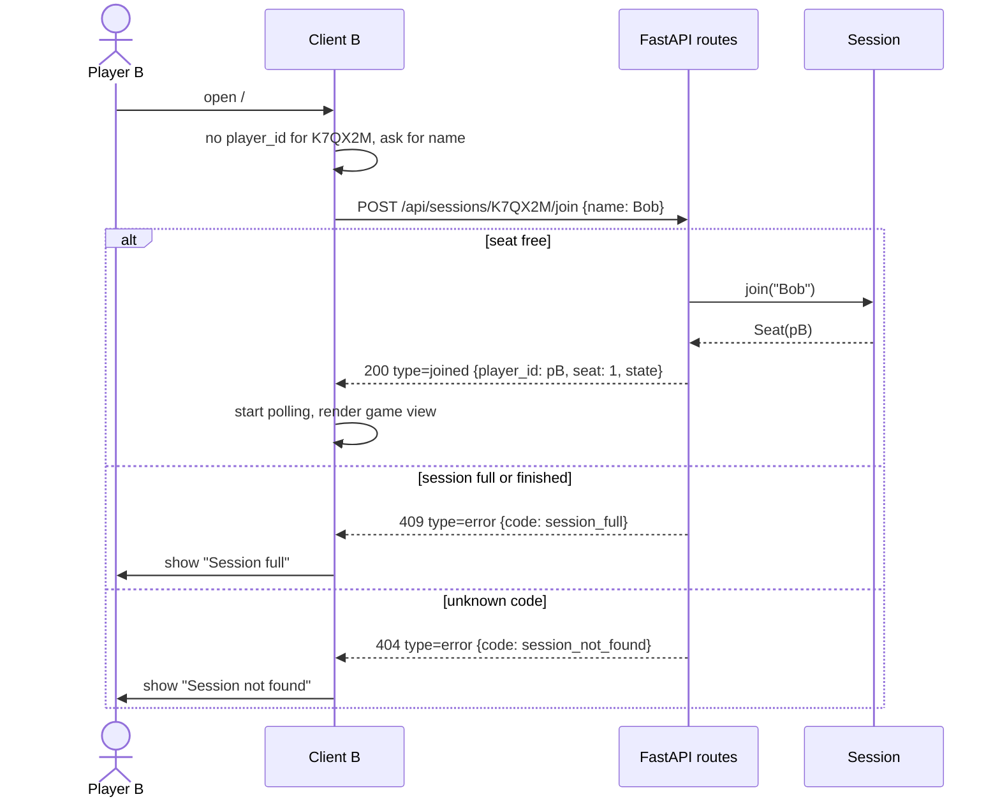
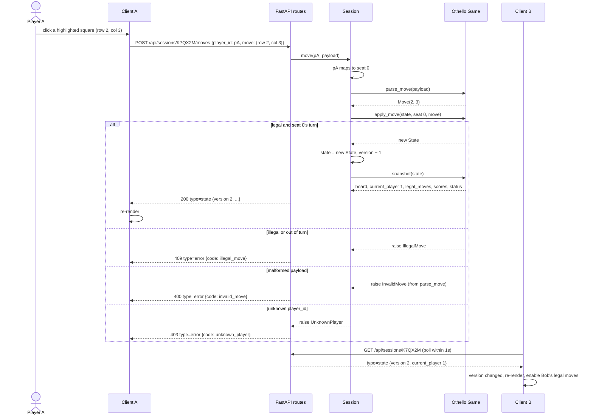
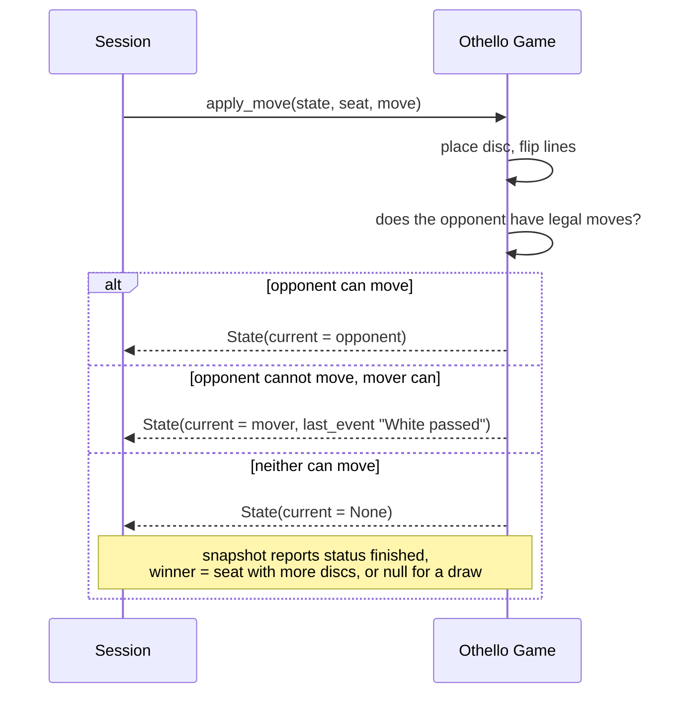
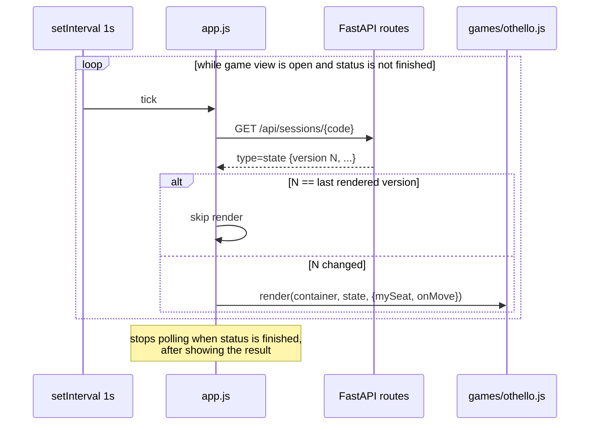

# Sequence Diagrams — Main Flows

Companion to `design.md`. Every request and response body uses the `{"v": 1, "type", "payload"}` envelope (Design Decision 9). The diagrams show only the `type` and the key payload fields.

## 1. Browse Directory and Lobby

## 2. Create a Session and Join from the Lobby

## 3. Join via a Shared Link

The `#/{game}/{code}` route has no `player_id` in memory, so the client joins first. A full session returns `409`.

## 4. Make a Move (Happy Path and Rejections)

## 5. Automatic Pass and Game Over (inside the Othello module)

The core sees only a new state and a snapshot. Passing and game end are decided entirely in `apply_move`.

## 6. Polling Loop (client side)

